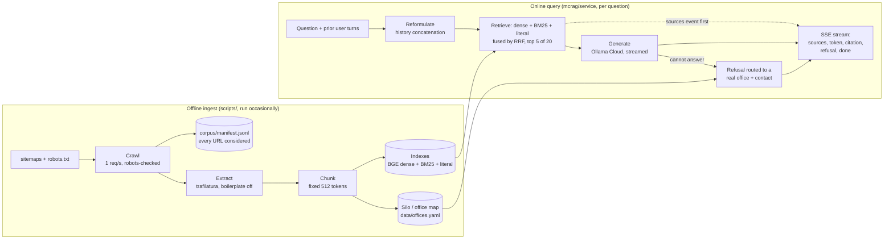

# Maryville College RAG

A retrieval-augmented question-answering system over the public web presence of
**Maryville College** (Maryville, Tennessee) — `maryvillecollege.edu` and its
SmartCatalogIQ course catalog.

The interesting question is not "can a language model answer questions about a
college website." It is whether a small, cheap, mostly-local pipeline can answer
**cross-silo** questions — ones whose answer is spread across the pages of two or
more offices that do not link to each other — and whether it knows when to say it
does not know.

> Not affiliated with Maryville University in St. Louis, a different institution.

## Crawl policy

Three lines, and they are enforced in code rather than promised in a document:

1. **Public pages only.** No authenticated content, no student records. There is
   no FERPA surface in this project and it stays that way.
2. **One request per second**, with a user agent naming the project and a contact
   address. A crawl without a reachable contact fails loudly rather than running.
3. **`robots.txt` is honored.** Every URL passes the robots check before a fetch
   is attempted, and a refusal is recorded in the crawl manifest with the exact
   rule that matched.

Every URL the crawler *considers* gets a manifest record, fetched or not. A
corpus that records only its successes cannot tell you what is missing from it.

## Architecture

Two paths that share one corpus: an **offline ingest** path run occasionally, and
an **online query** path run per question. Every box below is a class behind an
interface in `mcrag/interfaces.py`, named by config, so an ablation arm is a
config value rather than an edited function.



Retrieval runs on the rewritten query, but the answer is generated against the
original question (`decisions/0015`). The service keeps no
conversation state; the client sends prior user turns with each request. The wire
format is specified in `docs/stream_contract.md`. Two clients read it:
`clients/reference_client.html`, the disposable fixture that proved the document
is enough to build from (Task 29), and `clients/chat.html`, a conversational
client that is kept. The second is a new file rather than a restyling of the
first, which is what the fixture's own header asks for.

## Corpus coverage

Counted from `corpus/manifest.jsonl` (regenerate with
`python scripts/coverage.py --markdown`; full breakdown in `docs/coverage.md`).
**5,479 URLs were considered** and each has a manifest record:

| Status | URLs | Share |
|---|---:|---:|
| fetched | 1,847 | 33.7% |
| excluded | 3,421 | 62.4% |
| failed | 211 | 3.9% |

Exclusions are `policy` 1,879 (34.3%), `robots_disallow` 1,146 (20.9%) and
`extraction_empty` 396 (7.2%); failures are `http_error` 211 (3.9%). The
roughly two-thirds not fetched is the corpus's stated limit: a question whose
answer lives on an excluded page cannot be answered, and the system is meant to
refuse rather than guess.

## Documents

| File | What it is |
|---|---|
| `PLAN.md` | The design doc: what is being built and why |
| `tasks/plan.md` | The execution plan: ordered tasks, acceptance criteria, verification |
| `tasks/todo.md` | The backlog |
| `decisions/` | Decisions made once and not relitigated |
| `RESULTS.md` | Generated from `runs/`, never hand-edited |
| `docs/LIMITATIONS.md` | What the results cannot show, what moved the numbers, the test-split access log |

## Development conventions

Every swappable pipeline stage is a class behind an interface, named by
`config.yaml` and instantiated by the runner. An ablation arm is a config value,
not an edited function body. Checkpoints A through H are the sprint boundaries;
each one demonstrates working software or it is not done. Both conventions are
spelled out in `tasks/plan.md`.

## Setup

```bash
python -m venv .venv && .venv/Scripts/activate   # Windows; use .venv/bin/activate elsewhere
pip install -e ".[dev,service,index,scoring]"   # tests import all four extras
pytest
```

On a fresh clone `pytest` gives 626 passed, 2 failed (verified 2026-09-24). The two
failures (`tests/test_gold_v1.py`) need `corpus/chunks.jsonl`, a gitignored build
artifact; `corpus/` and `indexes/` are rebuilt by the ingest scripts in order
(`fetch_corpus`, `extract_corpus`, `chunk_corpus`, `build_indexes`), and the
embedding install is large (torch).

Generation runs against Ollama Cloud's free tier. Copy `.env.example` to `.env`
and fill in the key; embedding and reranking run locally and need no key.

To serve the API (`POST /ask`, `GET /health`), run:

```bash
uvicorn mcrag.service.api:app
```

To try a client with no key of your own and no generation quota, run
`python scripts/serve_reference_client_demo.py` (Task 29's fixture) or
`python scripts/serve_reference_client_demo.py --client chat` (the chat client)
and open the URL it prints. It fakes generation only; everything below the
transport is real.

`clients/chat.html` is checked by `node clients/verify_chat_client.mjs`, which
drives its real event handlers under a small DOM shim against captured server
frames and asserts the five properties a chat UI loses first: sources on screen
before any token, citations spliced at the server's `claim_span` offsets, a
refusal built from `office`/`contact_url`/`email` rather than from prose, a
`null` latency stage shown as `—` rather than `0 ms`, and SSE read over `fetch`
rather than `EventSource`. It needs `node`; `pytest` does not run it, and
nothing else in the repo depends on node.

`clients/chat.html` **has** now been opened in a real browser, against the
zero-quota demo server — enough to catch two things the DOM shim could not: a
clipped two-line placeholder in the composer, and the fact that a stream whose
body ends without a `done` event was reading as a finished answer and banking
the question into the conversation memory. Both are fixed, and the second is
now check 11 in the verifier. What is still unverified in a browser is the part
that needs quota: **no client has been driven against live `gemma4:31b`**, so a
real answer's tokens, citation markers, and timings have never been watched
arrive. That gap is unchanged.

## Results

`RESULTS.md` is regenerated from `runs/` by `python scripts/generate_results.py`
(never hand-edited): every run with its split, n, quality and median cost, the
3a/3c baselines marked as controls, and a quality/cost Pareto frontier. The
ablation table, not the demo, is the centerpiece.

## Status

Backend complete through Checkpoint F, plus Phase 6b service hardening
(Checkpoint 6b). **Checkpoint G closed 2026-09-30**, with its "demo recorded"
criterion struck by an amendment logged in `decisions/0019` — the gate's own
second criterion already made the ablation table the centerpiece and the demo
secondary. `RESULTS.md` and `results_pareto.svg` regenerate byte-identically. The live-quota checks have now been run against real
`gemma4:31b`: `curl -N POST /ask` over real SSE, a 16-case injection regression
(`docs/injection_regression_report.md`), and the streaming timing measurement —
which **failed its claim**, so the "sources arrive at least 1 s before the first
token" claim was dropped rather than fixed, and only the tested ordering property
is claimed (`docs/LIMITATIONS.md` §7).

Two structured-refusal A/Bs have since been run on dev and **both rejected**. T41
(`decisions/0017`): the model emits the `DECISION:` field reliably and it catches every
out-of-scope case, but putting the label first suppresses partial answers. T41b
(`decisions/0018`) moved the label to the end, which fixed that — no content losses,
longer answers, no out-of-scope question answered at all — yet pooled `refusal_correct`
came to +0.033 [−0.050, +0.133], about two question flips in sixty, so it failed the
pre-registered primary too. Under the stopping rule that closes the labelling route: the
frozen prompt stands unchanged and layer 5 ships with its blind spot measured and
documented rather than patched.

Not yet done: the recorded demo (T33) and Phase 7 maintenance. **No demo
exists** — closing Checkpoint G without it says the portfolio artifacts are done,
not that the project has a walkthrough. T33 also has a real blocker beyond
scheduling: the `TAU` gate refuses every cross-silo dev question, so the
cross-silo third of that walkthrough has nothing to show until the over-refusal
is addressed. The reference client's real-browser pass covered the zero-quota demo
server only, and sources-render-before-answer is measured (T42), never filmed.
Everything open is recorded in `tasks/plan.md` rather than claimed.
