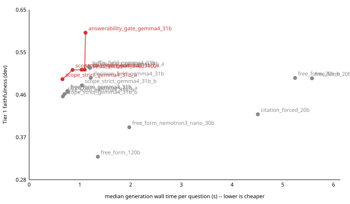

# RESULTS

Regenerated from `runs/` by `scripts/generate_results.py` -- never hand-edited.

Cost is the **median** per-question generation wall time (PLAN 4f: never the mean) with mean completion tokens; `--` means the run made no generation calls. Quality cells are `value [95% CI] (n=questions)`.

| run | arm | role | split | recall@k | mrr | ndcg@k | all_golds_retrieved@k | faithfulness | cost |
|---|---|---|---|---|---|---|---|---|---|
| 20260910T224550Z_f4f0da4d39e0 | calibration |  | dev | -- | -- | -- | -- | -- | 2.32s median, 176 tok (n=20) |
| 20260914T203423Z_318f7310fe60 | 3a-dense-only-naive-chunks | control 3a | dev | 0.667 [0.542, 0.781] (n=48) | 0.614 [0.492, 0.733] (n=48) | 0.587 [0.474, 0.695] (n=48) | 0.562 [0.417, 0.708] (n=48) | -- | -- |
| 20260916T220036Z_99edd3c1a0f1 | bp_off-fixed512-fusion_off-rerank_off-silo_off |  | dev | 0.667 [0.542, 0.781] (n=48) | 0.602 [0.482, 0.719] (n=48) | 0.579 [0.467, 0.685] (n=48) | 0.562 [0.417, 0.708] (n=48) | -- | -- |
| 20260916T220117Z_33938cf22c2f | bp_off-fixed512-fusion_off-rerank_off-silo_on |  | dev | 0.667 [0.542, 0.781] (n=48) | 0.602 [0.482, 0.719] (n=48) | 0.579 [0.467, 0.685] (n=48) | 0.562 [0.417, 0.708] (n=48) | -- | -- |
| 20260916T220138Z_ddf0b70bdd5c | bp_off-fixed512-fusion_off-rerank_on-silo_off |  | dev | 0.740 [0.625, 0.844] (n=48) | 0.687 [0.569, 0.799] (n=48) | 0.675 [0.561, 0.781] (n=48) | 0.667 [0.542, 0.792] (n=48) | -- | -- |
| 20260916T220833Z_df24e5cd3e33 | bp_off-fixed512-fusion_off-rerank_on-silo_on |  | dev | 0.740 [0.625, 0.844] (n=48) | 0.687 [0.569, 0.799] (n=48) | 0.675 [0.561, 0.781] (n=48) | 0.667 [0.542, 0.792] (n=48) | -- | -- |
| 20260916T221008Z_9be9c80f18b3 | bp_off-fixed512-fusion_on-rerank_off-silo_off |  | dev | 0.771 [0.656, 0.875] (n=48) | 0.624 [0.510, 0.733] (n=48) | 0.646 [0.536, 0.748] (n=48) | 0.708 [0.583, 0.833] (n=48) | -- | -- |
| 20260916T221020Z_706094942892 | bp_off-fixed512-fusion_on-rerank_off-silo_on |  | dev | 0.771 [0.656, 0.875] (n=48) | 0.624 [0.510, 0.733] (n=48) | 0.646 [0.536, 0.748] (n=48) | 0.708 [0.583, 0.833] (n=48) | -- | -- |
| 20260916T221031Z_9fd90e95e100 | bp_off-fixed512-fusion_on-rerank_on-silo_off |  | dev | 0.771 [0.667, 0.865] (n=48) | 0.698 [0.582, 0.805] (n=48) | 0.694 [0.585, 0.796] (n=48) | 0.688 [0.562, 0.812] (n=48) | -- | -- |
| 20260916T221046Z_eb38365457e6 | bp_off-fixed512-fusion_on-rerank_on-silo_on |  | dev | 0.771 [0.667, 0.865] (n=48) | 0.698 [0.582, 0.805] (n=48) | 0.694 [0.585, 0.796] (n=48) | 0.688 [0.562, 0.812] (n=48) | -- | -- |
| 20260916T221103Z_bcc837113237 | bp_off-paragraph-fusion_off-rerank_off-silo_off |  | dev | 0.698 [0.583, 0.802] (n=48) | 0.628 [0.514, 0.741] (n=48) | 0.618 [0.509, 0.724] (n=48) | 0.604 [0.458, 0.750] (n=48) | -- | -- |
| 20260916T221123Z_e23a3830db02 | bp_off-paragraph-fusion_off-rerank_off-silo_on |  | dev | 0.698 [0.583, 0.802] (n=48) | 0.628 [0.514, 0.741] (n=48) | 0.618 [0.509, 0.724] (n=48) | 0.604 [0.458, 0.750] (n=48) | -- | -- |
| 20260916T221143Z_7d76f32ce00a | bp_off-paragraph-fusion_off-rerank_on-silo_off |  | dev | 0.719 [0.604, 0.833] (n=48) | 0.708 [0.590, 0.819] (n=48) | 0.683 [0.568, 0.794] (n=48) | 0.646 [0.521, 0.771] (n=48) | -- | -- |
| 20260916T221205Z_591f823ecd0b | bp_off-paragraph-fusion_off-rerank_on-silo_on |  | dev | 0.719 [0.604, 0.833] (n=48) | 0.708 [0.590, 0.819] (n=48) | 0.683 [0.568, 0.794] (n=48) | 0.646 [0.521, 0.771] (n=48) | -- | -- |
| 20260916T221228Z_a442a9f44134 | bp_off-paragraph-fusion_on-rerank_off-silo_off |  | dev | 0.729 [0.615, 0.833] (n=48) | 0.686 [0.567, 0.801] (n=48) | 0.663 [0.551, 0.770] (n=48) | 0.646 [0.521, 0.771] (n=48) | -- | -- |
| 20260916T221249Z_c0546a4ea050 | bp_off-paragraph-fusion_on-rerank_off-silo_on |  | dev | 0.729 [0.615, 0.833] (n=48) | 0.686 [0.567, 0.801] (n=48) | 0.663 [0.551, 0.770] (n=48) | 0.646 [0.521, 0.771] (n=48) | -- | -- |
| 20260916T221309Z_a9e2aee7cc3c | bp_off-paragraph-fusion_on-rerank_on-silo_off |  | dev | 0.740 [0.625, 0.844] (n=48) | 0.702 [0.586, 0.812] (n=48) | 0.685 [0.573, 0.791] (n=48) | 0.646 [0.500, 0.771] (n=48) | -- | -- |
| 20260916T221333Z_5dbd5fbd9a10 | bp_off-paragraph-fusion_on-rerank_on-silo_on |  | dev | 0.740 [0.625, 0.844] (n=48) | 0.702 [0.586, 0.812] (n=48) | 0.685 [0.573, 0.791] (n=48) | 0.646 [0.500, 0.771] (n=48) | -- | -- |
| 20260916T221356Z_6a7d63d753a3 | bp_on-fixed512-fusion_off-rerank_off-silo_off |  | dev | 0.667 [0.542, 0.781] (n=48) | 0.614 [0.492, 0.733] (n=48) | 0.587 [0.474, 0.695] (n=48) | 0.562 [0.417, 0.708] (n=48) | -- | -- |
| 20260916T221414Z_f20c10afab75 | bp_on-fixed512-fusion_off-rerank_off-silo_on |  | dev | 0.594 [0.469, 0.719] (n=48) | 0.570 [0.445, 0.692] (n=48) | 0.541 [0.423, 0.657] (n=48) | 0.500 [0.354, 0.646] (n=48) | -- | -- |
| 20260916T221432Z_8c95b1942501 | bp_on-fixed512-fusion_off-rerank_on-silo_off |  | dev | 0.750 [0.646, 0.854] (n=48) | 0.708 [0.592, 0.817] (n=48) | 0.688 [0.578, 0.792] (n=48) | 0.667 [0.542, 0.792] (n=48) | -- | -- |
| 20260916T221453Z_d81f1752cf69 | bp_on-fixed512-fusion_off-rerank_on-silo_on |  | dev | 0.750 [0.646, 0.854] (n=48) | 0.708 [0.592, 0.817] (n=48) | 0.688 [0.578, 0.792] (n=48) | 0.667 [0.542, 0.792] (n=48) | -- | -- |
| 20260916T221515Z_21aa826032fe | bp_on-fixed512-fusion_on-rerank_off-silo_off |  | dev | 0.750 [0.635, 0.854] (n=48) | 0.638 [0.521, 0.749] (n=48) | 0.652 [0.538, 0.759] (n=48) | 0.688 [0.562, 0.812] (n=48) | -- | -- |
| 20260916T221534Z_2e8ee1cd089e | bp_on-fixed512-fusion_on-rerank_off-silo_on |  | dev | 0.615 [0.479, 0.740] (n=48) | 0.530 [0.403, 0.653] (n=48) | 0.528 [0.406, 0.646] (n=48) | 0.542 [0.396, 0.688] (n=48) | -- | -- |
| 20260916T221555Z_d5f2cbf847fd | bp_on-fixed512-fusion_on-rerank_on-silo_off |  | dev | 0.781 [0.677, 0.875] (n=48) | 0.695 [0.578, 0.804] (n=48) | 0.696 [0.586, 0.797] (n=48) | 0.708 [0.583, 0.833] (n=48) | -- | -- |
| 20260916T221619Z_c85bb6e59450 | bp_on-fixed512-fusion_on-rerank_on-silo_on |  | dev | 0.781 [0.677, 0.875] (n=48) | 0.695 [0.578, 0.804] (n=48) | 0.696 [0.586, 0.797] (n=48) | 0.708 [0.583, 0.833] (n=48) | -- | -- |
| 20260916T221644Z_2ecf0c19e294 | bp_on-paragraph-fusion_off-rerank_off-silo_off |  | dev | 0.698 [0.583, 0.802] (n=48) | 0.639 [0.524, 0.752] (n=48) | 0.626 [0.516, 0.733] (n=48) | 0.604 [0.458, 0.750] (n=48) | -- | -- |
| 20260916T221704Z_d875cfc69a4b | bp_on-paragraph-fusion_off-rerank_off-silo_on |  | dev | 0.667 [0.542, 0.781] (n=48) | 0.589 [0.472, 0.705] (n=48) | 0.597 [0.476, 0.718] (n=48) | 0.583 [0.438, 0.729] (n=48) | -- | -- |
| 20260916T221724Z_f2d12b698cc1 | bp_on-paragraph-fusion_off-rerank_on-silo_off |  | dev | 0.719 [0.604, 0.833] (n=48) | 0.708 [0.590, 0.819] (n=48) | 0.683 [0.568, 0.794] (n=48) | 0.646 [0.521, 0.771] (n=48) | -- | -- |
| 20260916T221739Z_a630a9ae9d6e | bp_on-paragraph-fusion_off-rerank_on-silo_on |  | dev | 0.719 [0.604, 0.833] (n=48) | 0.708 [0.590, 0.819] (n=48) | 0.683 [0.568, 0.794] (n=48) | 0.646 [0.521, 0.771] (n=48) | -- | -- |
| 20260916T221752Z_e241bd7cc7ce | bp_on-paragraph-fusion_on-rerank_off-silo_off |  | dev | 0.740 [0.625, 0.844] (n=48) | 0.709 [0.592, 0.818] (n=48) | 0.681 [0.572, 0.786] (n=48) | 0.646 [0.521, 0.771] (n=48) | -- | -- |
| 20260916T221804Z_938009e32755 | bp_on-paragraph-fusion_on-rerank_off-silo_on |  | dev | 0.656 [0.531, 0.771] (n=48) | 0.585 [0.459, 0.707] (n=48) | 0.581 [0.461, 0.696] (n=48) | 0.583 [0.438, 0.729] (n=48) | -- | -- |
| 20260916T221817Z_0bccdadf7b83 | bp_on-paragraph-fusion_on-rerank_on-silo_off |  | dev | 0.760 [0.656, 0.854] (n=48) | 0.706 [0.592, 0.815] (n=48) | 0.693 [0.584, 0.797] (n=48) | 0.667 [0.521, 0.792] (n=48) | -- | -- |
| 20260916T221832Z_624eb6feedbf | bp_on-paragraph-fusion_on-rerank_on-silo_on |  | dev | 0.760 [0.656, 0.854] (n=48) | 0.706 [0.592, 0.815] (n=48) | 0.693 [0.584, 0.797] (n=48) | 0.667 [0.521, 0.792] (n=48) | -- | -- |
| 20260917T032746Z_77e78976ead3 | phase3c-baseline | control 3c | dev | 0.771 [0.656, 0.875] (n=48) | 0.624 [0.510, 0.733] (n=48) | 0.646 [0.536, 0.748] (n=48) | 0.708 [0.583, 0.833] (n=48) | 0.400 [0.307, 0.493] (n=50) | -- |
| 20260917T044122Z_c1d4b7284f0f | phase3c-baseline | control 3c | dev | 0.771 [0.656, 0.875] (n=48) | 0.624 [0.510, 0.733] (n=48) | 0.646 [0.536, 0.748] (n=48) | 0.708 [0.583, 0.833] (n=48) | 0.435 [0.329, 0.540] (n=50) | -- |
| 20260917T133042Z_340a8f03a310 | t21-ce-maxp-gate |  | train+dev | -- | -- | -- | -- | -- | -- |
| 20260917T193056Z_2daaf8417c6f | citation_forced_20b |  | dev | 0.771 [0.656, 0.875] (n=48) | 0.624 [0.510, 0.733] (n=48) | 0.646 [0.536, 0.748] (n=48) | 0.708 [0.583, 0.833] (n=48) | 0.419 [0.317, 0.522] (n=59) | 4.51s median, 338 tok (n=60) |
| 20260917T193056Z_2fb9337bf127 | free_form_120b |  | dev | 0.771 [0.656, 0.875] (n=48) | 0.624 [0.510, 0.733] (n=48) | 0.646 [0.536, 0.748] (n=48) | 0.708 [0.583, 0.833] (n=48) | 0.326 [0.233, 0.427] (n=50) | 1.35s median, 275 tok (n=60) |
| 20260917T193056Z_35ca88781e93 | free_form_nemotron3_nano_30b |  | dev | 0.771 [0.656, 0.875] (n=48) | 0.624 [0.510, 0.733] (n=48) | 0.646 [0.536, 0.748] (n=48) | 0.708 [0.583, 0.833] (n=48) | 0.391 [0.292, 0.492] (n=51) | 1.97s median, 431 tok (n=60) |
| 20260917T193056Z_4bb32ea47677 | free_form_gemma4_31b |  | dev | 0.771 [0.656, 0.875] (n=48) | 0.624 [0.510, 0.733] (n=48) | 0.646 [0.536, 0.748] (n=48) | 0.708 [0.583, 0.833] (n=48) | 0.470 [0.359, 0.579] (n=50) | 0.75s median, 94 tok (n=60) |
| 20260917T193056Z_6952a305644b | free_form_20b_a |  | dev | 0.771 [0.656, 0.875] (n=48) | 0.624 [0.510, 0.733] (n=48) | 0.646 [0.536, 0.748] (n=48) | 0.708 [0.583, 0.833] (n=48) | 0.497 [0.380, 0.613] (n=50) | 5.58s median, 395 tok (n=60) |
| 20260917T193056Z_8823a80a8a6a | free_form_20b_b |  | dev | 0.771 [0.656, 0.875] (n=48) | 0.624 [0.510, 0.733] (n=48) | 0.646 [0.536, 0.748] (n=48) | 0.708 [0.583, 0.833] (n=48) | 0.498 [0.390, 0.609] (n=52) | 5.24s median, 408 tok (n=60) |
| 20260918T002607Z_ab805dae081a | rung0_identity |  | dev | 0.771 [0.656, 0.875] (n=48) | 0.624 [0.510, 0.733] (n=48) | 0.646 [0.536, 0.748] (n=48) | 0.708 [0.583, 0.833] (n=48) | -- | -- |
| 20260918T002642Z_cba0ea816fc7 | rung1_acronym_dict |  | dev | 0.771 [0.667, 0.865] (n=48) | 0.634 [0.523, 0.743] (n=48) | 0.649 [0.543, 0.751] (n=48) | 0.688 [0.562, 0.812] (n=48) | -- | -- |
| 20260922T151047Z_18b214bce36b | t22b_baseline_20b_a |  | test | 0.656 [0.568, 0.745] (n=96) | 0.566 [0.481, 0.653] (n=96) | 0.564 [0.484, 0.646] (n=96) | 0.583 [0.490, 0.688] (n=96) | 0.414 [0.336, 0.494] (n=99) | 6.01s median, 376 tok (n=120) |
| 20260922T151047Z_4185e547c9ee | t22b_baseline_20b_b |  | test | 0.656 [0.568, 0.745] (n=96) | 0.566 [0.481, 0.653] (n=96) | 0.564 [0.484, 0.646] (n=96) | 0.583 [0.490, 0.688] (n=96) | 0.436 [0.359, 0.512] (n=99) | 5.89s median, 391 tok (n=120) |
| 20260922T151047Z_9a6295b654ee | t22b_frozen_gemma4_31b |  | test | 0.656 [0.568, 0.745] (n=96) | 0.566 [0.481, 0.653] (n=96) | 0.564 [0.484, 0.646] (n=96) | 0.583 [0.490, 0.688] (n=96) | 0.345 [0.269, 0.424] (n=105) | 0.80s median, 78 tok (n=120) |
| 20260922T201857Z_3caf1dd6d3bd | free_form_gemma4_31b_a |  | dev | 0.771 [0.656, 0.875] (n=48) | 0.624 [0.510, 0.733] (n=48) | 0.646 [0.536, 0.748] (n=48) | 0.708 [0.583, 0.833] (n=48) | 0.467 [0.358, 0.577] (n=51) | 0.76s median, 92 tok (n=60) |
| 20260922T201857Z_9204bbc586dd | free_form_gemma4_31b_b |  | dev | 0.771 [0.656, 0.875] (n=48) | 0.624 [0.510, 0.733] (n=48) | 0.646 [0.536, 0.748] (n=48) | 0.708 [0.583, 0.833] (n=48) | 0.463 [0.347, 0.576] (n=51) | 0.70s median, 92 tok (n=60) |
| 20260922T201857Z_d6b307f5beff | scope_strict_gemma4_31b |  | dev | 0.771 [0.656, 0.875] (n=48) | 0.624 [0.510, 0.733] (n=48) | 0.646 [0.536, 0.748] (n=48) | 0.708 [0.583, 0.833] (n=48) | 0.515 [0.393, 0.640] (n=47) | 0.85s median, 82 tok (n=60) |
| 20260924T000403Z_149ac5161451 | scope_strict_gemma4_31b_b |  | dev | 0.771 [0.656, 0.875] (n=48) | 0.624 [0.510, 0.733] (n=48) | 0.646 [0.536, 0.748] (n=48) | 0.708 [0.583, 0.833] (n=48) | 0.458 [0.334, 0.581] (n=49) | 0.66s median, 80 tok (n=60) |
| 20260924T000403Z_7b06f82076c9 | scope_strict_gemma4_31b_a |  | dev | 0.771 [0.656, 0.875] (n=48) | 0.624 [0.510, 0.733] (n=48) | 0.646 [0.536, 0.748] (n=48) | 0.708 [0.583, 0.833] (n=48) | 0.495 [0.371, 0.618] (n=48) | 0.66s median, 79 tok (n=60) |
| 20260924T000403Z_a71396ad59bd | answerability_gate_gemma4_31b |  | dev | 0.771 [0.656, 0.875] (n=48) | 0.624 [0.510, 0.733] (n=48) | 0.646 [0.536, 0.748] (n=48) | 0.708 [0.583, 0.833] (n=48) | 0.597 [0.431, 0.752] (n=29) | 1.11s median, 36 tok (n=60) |

## Task 18: free retrieval factorial -- main effects and interactions

`all_golds_retrieved@5`, 32 cells, dev split, zero generation quota. Effects are in the metric's own units (a difference of means, PLAN Sec 4b's "worth +X" framing); interactions follow the standard half-the-difference-of-simple-effects convention -- see `mcrag.eval.factorial`.

### Main effects

| factor | effect |
|---|---|
| reranker | +0.0573 |
| fusion | +0.0469 |
| silo_boost | -0.0182 |
| boilerplate | -0.0156 |
| chunking_fixed512 | +0.0104 |

### Two-way interactions

| factors | effect |
|---|---|
| chunking_fixed512*fusion | +0.0260 |
| fusion*reranker | -0.0260 |
| boilerplate*reranker | +0.0260 |
| chunking_fixed512*reranker | +0.0208 |
| boilerplate*silo_boost | -0.0182 |
| reranker*silo_boost | +0.0182 |
| boilerplate*chunking_fixed512 | -0.0104 |
| chunking_fixed512*silo_boost | -0.0078 |
| fusion*silo_boost | -0.0078 |
| boilerplate*fusion | -0.0052 |

## Quality / cost Pareto frontier (PLAN 4b)

Dev split, generation runs only. Quality is Tier 1 faithfulness (the primary generation metric, `decisions/0006`); cost is the median per-question wall time. Frontier points (red) are not beaten on both axes by any other run. Cost is cloud wall time, so it carries queue and cold-start noise: read the spread between same-model reruns as the noise floor before reading any frontier gap as an effect. Faithfulness alone can be bought by refusing more, so a frontier point is not an endorsement: check `refusal_correct` in the table above (`answerability_gate` sits on this frontier and was rejected in `decisions/0014` for exactly that). Test-split runs are in the table above, deliberately not on this frontier.

| run | arm | faithfulness | median wall_s | on frontier |
|---|---|---|---|---|
| 20260924T000403Z_7b06f82076c9 | scope_strict_gemma4_31b_a | 0.495 | 0.66 | yes |
| 20260924T000403Z_149ac5161451 | scope_strict_gemma4_31b_b | 0.458 | 0.66 |  |
| 20260922T201857Z_9204bbc586dd | free_form_gemma4_31b_b | 0.463 | 0.70 |  |
| 20260917T193056Z_4bb32ea47677 | free_form_gemma4_31b | 0.470 | 0.75 |  |
| 20260922T201857Z_3caf1dd6d3bd | free_form_gemma4_31b_a | 0.467 | 0.76 |  |
| 20260922T201857Z_d6b307f5beff | scope_strict_gemma4_31b | 0.515 | 0.85 | yes |
| 20260924T000403Z_a71396ad59bd | answerability_gate_gemma4_31b | 0.597 | 1.11 | yes |
| 20260917T193056Z_2fb9337bf127 | free_form_120b | 0.326 | 1.35 |  |
| 20260917T193056Z_35ca88781e93 | free_form_nemotron3_nano_30b | 0.391 | 1.97 |  |
| 20260917T193056Z_2daaf8417c6f | citation_forced_20b | 0.419 | 4.51 |  |
| 20260917T193056Z_8823a80a8a6a | free_form_20b_b | 0.498 | 5.24 |  |
| 20260917T193056Z_6952a305644b | free_form_20b_a | 0.497 | 5.58 |  |
